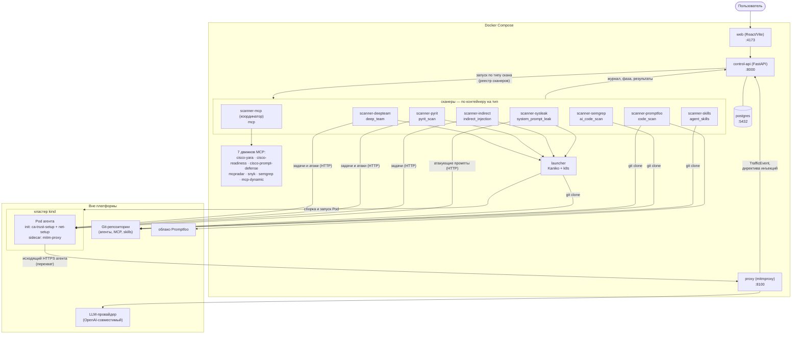

# Agent Scanner

Платформа для проверки безопасности LLM-агентов с вызовом инструментов
(tool calling) и MCP-серверов:

- **динамическое тестирование** — платформа запускает агента и атакует его:
  DeepTeam, Microsoft PyRIT (промпты с конвертерами, RedTeaming, Crescendo),
  косвенные промпт-инъекции через результаты инструментов, попытки вытащить
  системный промпт;
- **статический анализ кода** — исходники агента проверяются облаком
  Promptfoo или локальным Semgrep по правилам для AI/LLM-кода (без запуска
  агента);
- **перехват трафика** — реальный HTTPS-трафик агента к LLM прозрачно
  перехватывается и журналируется: по каждому обмену видно тело запроса и
  ответа;
- **тестирование MCP-серверов** — SAST по исходникам и MCPB-архивам,
  анализ каталога инструментов и контролируемые динамические вызовы
  (семь движков).

Тестируемый агент подключается **без единой правки**: его собственные ключи
и адрес LLM-провайдера остаются нетронутыми.

## Схема архитектуры



Схема упрощённая: у всех сканеров единый контракт (`GET /health`,
`GET /schema`, `POST /run/{scan_id}` — ответ сразу, работа в фоне), а
прогресс и результаты каждый пишет в control-api через API. Связка
«тип скана → сервис» — реестр `control-api/app/scanner_registry.py`,
единственное место, где она определена.

## Как подключается агент

Ключевой принцип — **ноль изменений в тестируемом агенте**. Его реальная
конфигурация LLM (`OPENAI_API_KEY`, `OPENAI_BASE_URL` и т.п.) не трогается.
Каждый Pod агента получает:

1. `ca-trust-setup` (initContainer) — подменяет системное хранилище
   доверенных сертификатов на связку «системные CA + корневой CA платформы»;
2. `net-setup` (initContainer) — правило iptables, перенаправляющее
   исходящий HTTPS на сайдкар;
3. сайдкар `mitm-proxy` — mitmproxy, который терминирует и заново
   подписывает соединение «на лету» (`proxy/addon.py`).

Прокси обычно только наблюдатель. В сканах `indirect_injection` и
`system_prompt_leak` он по директиве control-api дополнительно переписывает
тело запроса: подкладывает payload в результат инструмента или вставляет
метку в системное сообщение.

Агент может работать и без сборки: `source: remote` — уже запущенный вне
платформы сервис, для него доступны только динамические сканеры
(DeepTeam и PyRIT), трафик через прокси платформы не проходит.

## Активы и сканеры

Всё тестируемое хранится как активы в разделе «Активы», сканирование
создаётся внутри карточки актива:

| Актив | Источники | Доступные сканеры |
|---|---|---|
| Агент | `repository` (сборка платформой в kind) или `remote` (готовый HTTP-сервис) | 6 агентных сканеров (ниже) |
| MCP | `remote`-сервер, Git-репозиторий или `bundle` (загруженный MCPB-архив) | `mcp` |
| Skill | Git-репозиторий или zip-архив | `agent_skills` |

| Тип скана | Сервис | Что делает | Что нужно |
|---|---|---|---|
| `deep_team` | `scanner-deepteam` | Динамическое тестирование DeepTeam: сгенерированные атаки по выбранным уязвимостям, оценка ответов моделью-судьёй | Живой агент (собранный или remote), kind для сборки |
| `pyrit_scan` | `scanner-pyrit` | Microsoft PyRIT: одиночные промпты с конвертерами, адверсариальный диалог RedTeaming, постепенная эскалация Crescendo; судья — LLM-модель | То же |
| `indirect_injection` | `scanner-indirect` | Прокси подкладывает payload в результаты инструментов агента; оценка по контрольной метке (детерминированная, без судьи) | Агент под управлением платформы (MITM-под), kind |
| `system_prompt_leak` | `scanner-sysleak` | Метка вставляется в системное сообщение, атакующие промпты пытаются вытащить его; утечка = метка в ответе | То же |
| `code_scan` | `scanner-promptfoo` | Анализ кода в облаке Promptfoo: находки с файлом, строкой и рекомендацией | Репозиторий агента, `PROMPTFOO_API_KEY` |
| `ai_code_scan` | `scanner-semgrep` | Локальный Semgrep: AI-правила платформы + опциональные наборы Registry + свои YAML; код не покидает платформу | Репозиторий агента |
| `agent_skills` | `scanner-skills` | Навыки (`SKILL.md`) проверяются движками Cisco skill-scanner и NVIDIA SkillSpector со своими YARA-правилами и проверкой frontmatter; вердикт `pass`/`review`/`block` считает платформа, навыки не запускаются. Детали — [docs/skills-scan-architecture.md](docs/skills-scan-architecture.md) | Skill-актив |
| `mcp` | `scanner-mcp` | Координатор и семь движков: SAST (`semgrep`), YARA/эвристики Cisco, MCPRadar, Snyk (облако), динамические probes MCP-сессии | MCP-актив; детали — [docs/mcp-testing.md](docs/mcp-testing.md) |

Выбор сканера и его параметры форма берёт из `GET /scanners`: каждый сервис
описывает схему своего конфига на `GET /schema`, на фронте нет зашитых
списков опций. Реестр также определяет применимость сканера к активу
(нужен репозиторий / живой сервис / агент под управлением платформы).

## Сервисы

| Сервис | Порт | Роль |
|---|---|---|
| `control-api` | 8000 | FastAPI + SQLModel/**PostgreSQL**. Единый источник данных и REST API, Swagger — `/docs` |
| `postgres` | внутренний | Хранилище (том `agent-scanner_control-api-pg-data`) |
| `web` | 4173 | Дашборд React/Vite. **Весь текст интерфейса — на русском** |
| `proxy` | 8100 | mitmproxy-аддон: перехват и журналирование трафика агента к LLM, подкладывание инъекций |
| `launcher` | внутренний | Сборка образа агента (git-clone + Kaniko) и запуск Pod'а с MITM-сайдкаром в kind; браузер его не вызывает — разбор репозитория в мастере агента проксирует control-api |
| `scanner-deepteam`, `scanner-pyrit`, `scanner-indirect`, `scanner-sysleak` | внутренние | Динамические сканеры агентов (`scanner/<имя>`) |
| `scanner-promptfoo`, `scanner-semgrep` | внутренние | Статический анализ кода; kind не нужен |
| `scanner-mcp` + 7 движков | внутренние | Координатор MCP-сканов и контейнеры движков (общий образ) |
| `control-api-mitm-bridge` | — | `socat`-форвардер опубликованного порта control-api (quirk WSL2/Docker Desktop) |

Каталоги `generator/` и `interactor/` — легаси прежней архитектуры, в compose
не входят.

## Быстрый старт

Нужны Docker с Compose; для сканов с запуском агента — кластер Kubernetes
(локально `kind`, разовая настройка описана в
[docs/running-locally.md](docs/running-locally.md)).

```sh
cp .env.example .env   # заполнить LLM_PROVIDER_BASE_URL / _API_KEY / _MODEL
docker compose up -d --build
```

- Веб-интерфейс: <http://localhost:4173>
- REST API и Swagger: <http://localhost:8000/docs>

**Все LLM-вызовы идут в реального провайдера из `.env` — моков нет**,
результаты недетерминированы по замыслу. Учётные данные (`LLMModel.api_key`,
`AgentConfig.git_access_token`, `AgentConfig.env_vars`) хранятся в открытом
виде — принятый техдолг MVP. Для анализа кода нужен `PROMPTFOO_API_KEY`;
для Snyk — `SNYK_TOKEN`.

## Веб-интерфейс

| Страница | Назначение |
|---|---|
| `/` | Дашборд |
| `/assets` | Активы: агенты / MCP / skills; создание скана внутри карточки актива |
| `/scans`, `/scans/:id` | Список сканирований; живой журнал, фазы и результаты |
| `/llm-models` | LLM-модели (судьи и генераторы атак) |
| `/events` | Перехваченный трафик агента к LLM, тела запросов и ответов |
| `/library` | Библиотека знаний |
| `/help` | Справка по платформе |

## База данных

Хранилище — PostgreSQL (сервис `postgres`, подключение через `DATABASE_URL`).
`control-api` при старте применяет миграции Alembic (`app/db.py::init_db`);
меняя модели, добавляйте ревизию в `control-api/app/migrations/versions/`.

Не удаляйте том `agent-scanner_control-api-pg-data` — в нём сканы, журналы,
активы и MCPB-архивы. Старый том SQLite `agent-scanner_control-api-data`
сохранён: разовый перенос данных из него в PostgreSQL делает

```sh
docker compose run --rm \
  -v agent-scanner_control-api-data:/legacy:ro \
  control-api python scripts/migrate_sqlite_to_pg.py /legacy/control-api.db
```

Подробности — [docs/running-locally.md](docs/running-locally.md), раздел
«База данных и миграции».

## Библиотека знаний

`library/**/*.md` монтируется в control-api read-only и читается на лету:
категория — имя папки, метаданные — YAML-frontmatter. Новый материал
появляется в `/library` без пересборки.

## Ограничения

- Учётные данные в открытом виде (MVP), `git_access_token` может попасть
  в логи init-контейнера при неудачном клоне;
- нет автотестов — проверка живая: поднять сервисы, прогнать реальный
  сценарий, посмотреть `/events` и логи;
- часть моделей-провайдеров отклоняет генерацию атак по политике
  безопасности; анализ кода `code_scan` уходит в облако Promptfoo;
- перезапуск сервиса-сканера прерывает активный скан без продолжения;
- платформа рассчитана на локальный стенд, не на недоверенных
  пользователей.

## Документация

- [docs/architecture.md](docs/architecture.md) — подробная архитектура:
  компоненты, модель данных, прокси, каждый сканер, launcher;
- [docs/running-locally.md](docs/running-locally.md) — локальный запуск,
  настройка kind, сквозной сценарий сканирования, база данных и миграции;
- [docs/mcp-testing.md](docs/mcp-testing.md) — методы и границы
  MCP-анализа, семь движков, smoke-проверки;
- [docs/code-scan-architecture.md](docs/code-scan-architecture.md) — как
  устроен анализ кода через Promptfoo;
- [docs/system-prompt-leak.md](docs/system-prompt-leak.md) — сценарий
  утечки системного промпта;
- [AGENTS.md](AGENTS.md) — карта репозитория и соглашения для разработки.
